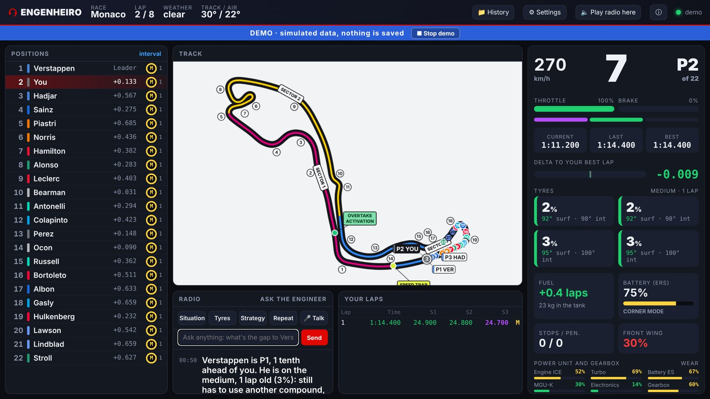
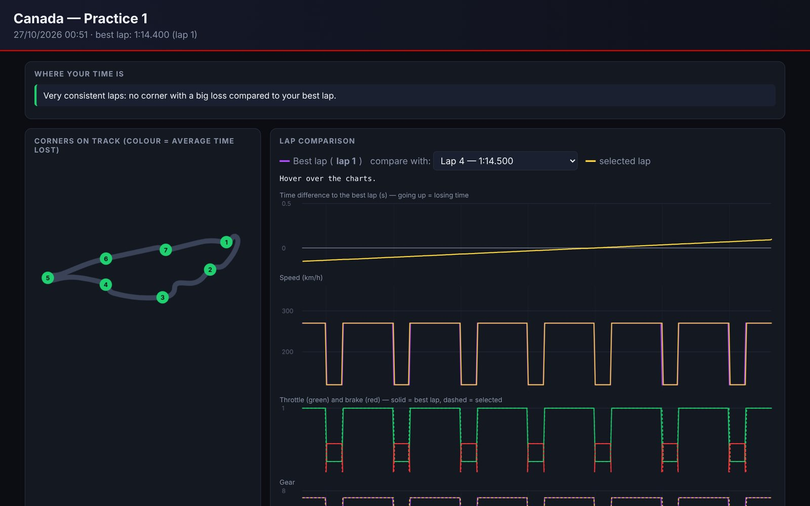

<h1 align="center">Engenheiro</h1>

<b>Um engenheiro de corrida por voz, gratuito, para o F1 25</b> · projeto de fã, não oficial · Windows

  <a href="https://github.com/yohanfv/engenheiro/releases/latest"><b>Baixar</b></a> ·
  <a href="README.md">English</a> ·
  <a href="CHANGELOG.md">Novidades</a> ·
  <a href="https://github.com/yohanfv/engenheiro/issues">Relatar um problema</a> ·
  <a href="https://ko-fi.com/yohanfv">Apoiar ☕</a>

O Engenheiro lê a telemetria do F1 25 e fala com você pelo rádio enquanto você pilota: diferenças, desgaste dos
pneus, Safety Car, chuva, "box, box", "defenda!", estratégia dos rivais, abandonos e muito mais. Você responde pelo
microfone, pelos botões do controle ou digitando. Funciona com o F1 25 no **PS5, Xbox ou PC**, em **português do
Brasil ou inglês**, sem cadastro, sem assinatura e sem IA paga.

## O que ele faz

- **Rádio de corrida:** tempos de volta e setores, diferença para quem está na frente e atrás (calculada como na
  cronometragem oficial), ultrapassagens ("Boa! Passou Leclerc!"), posições perdidas e por quê,
  "Overtake disponível! Ataque", "defenda!", últimas voltas e resultado.
- **Estratégia com o desgaste real dos seus pneus:** compara sem parada, uma e duas paradas com os jogos de pneus
  que sobraram e o tempo real de box de cada pista, chama o "box, box" na volta certa e refaz o plano no Safety Car.
- **De olho nos rivais:** abandonos (quem, onde e por quê), carros lentos ou parados, toques, asa quebrada dos
  rivais, quem perdeu tempo, quando os carros perto de você devem parar e chances de undercut e overcut.
- **Pergunte o que quiser:** "quanto falta pro Verstappen?", "o Leclerc já parou?", "o pneu aguenta até o fim?",
  "estou com saída de frente na entrada" (dicas de acerto). Diga **"Engenheiro"** e a pergunta; um bip curto de
  rádio confirma que ele ouviu. O reconhecimento de voz roda no seu PC.
- **Painel ao vivo:** mapa da pista no estilo oficial, com números das curvas e cores dos setores, torre de tempos,
  seu carro, temperatura e desgaste dos pneus, desgaste do motor e o rádio. Abre no celular também.
- **Aba Carro (tela de engenheiro):** o seu carro visto de cima com as temperaturas ao vivo dos pneus (superfície e
  miolo), freios e motor, alertas de dano, desgaste dos pneus e do motor, clima e previsão, acerto, últimos setores e
  gráficos de temperatura dos pneus, bateria/acelerador e delta para a sua melhor volta. Tudo vai do verde-escuro
  (perfeito) ao vermelho (crítico). O engenheiro continua falando em qualquer aba.
- **Análise dos treinos e relatórios:** ritmo comparado com a IA, onde cada pneu esquenta demais, sugestões de
  acerto, plano de corrida e um relatório curva a curva de onde você perde tempo.
- **Demonstração:** veja tudo funcionando sem o jogo (corrida, classificação ou treino simulados).

## Baixar e instalar

1. Baixe o `Engenheiro-x.y.z-windows.zip` mais recente na página de [versões](https://github.com/yohanfv/engenheiro/releases/latest).
2. Extraia numa pasta comum, por exemplo `C:\Engenheiro` (evite pastas do OneDrive).
3. Abra o **Engenheiro.exe**.
   - O Windows pode mostrar *"O Windows protegeu o computador"*, porque o programa não tem assinatura digital
     (o certificado é pago e este é um projeto gratuito). Clique em **Mais informações → Executar assim mesmo**.
     O código completo está neste repositório para quem quiser conferir ou gerar o programa por conta própria.
   - Quando o Firewall do Windows perguntar, permita em **Redes privadas**; sem isso os dados do jogo não chegam.
4. Uma tela de boas-vindas pergunta o idioma e mostra o IP que vai no jogo.

Requisitos: Windows 10 ou 11 na mesma rede do console (ou do PC onde roda o jogo) e internet na primeira vez
(a voz usa as vozes online da Microsoft; os modelos de fala são baixados uma vez).

## Configuração do jogo

No F1 25: **Configurações → Configurações de telemetria**

| Opção | Valor |
| --- | --- |
| Telemetria UDP | Sim |
| Transmissão (broadcast) | Não |
| Endereço IP | o IP que o Engenheiro mostra (jogando no mesmo PC? `127.0.0.1`) |
| Porta | 20777 |
| Frequência | 20 Hz |
| Formato UDP | 2025 (ou 2026 com o pacote da temporada 2026) |

Depois entre em qualquer sessão. O painel mostra **jogo conectado** e o engenheiro diz *"Rádio conectado. Estou com você."*

**Botões do controle (opcional):** no F1 25, Configurações → Controles → editar mapeamento, associe as *Ações UDP 1-7*:
1 situação · 2 pneus e combustível · 3 estratégia · 4 repetir · 5 falar · 6 teste de rádio · 7 estratégia dos rivais.

**SimHub junto:** só um programa pode usar a porta 20777. O Engenheiro repassa uma cópia dos dados para a porta
20778, então coloque a porta do jogo no SimHub como 20778.

**Rádio no celular:** abra `http://IP-DO-PC:8080` no celular, toque em *Ouvir rádio aqui* e use o fone. Dá para
desligar isso nas Configurações (painel só neste PC).

**Atualizações:** quando sair versão nova, aparece um botão verde **⬆ v…** no topo do painel. Baixe o zip novo e
extraia por cima da mesma pasta; suas configurações, sessões e acertos continuam lá. (A verificação só pergunta ao
GitHub o número da versão mais nova e pode ser desligada nas Configurações.)

## Problemas comuns

| Problema | Solução |
| --- | --- |
| "sem dados do jogo" | Confira o IP e a porta no jogo, permita o programa em Redes privadas no Firewall e veja se o PC e o console estão na mesma rede. |
| "A porta 20777 já está em uso" | Feche o SimHub ou outra cópia do programa, ou coloque o SimHub na porta 20778. |
| Não fala nada | Confira a internet e o volume. Sem internet ele usa a voz do Windows. |
| Microfone não responde | Configurações do Windows → Privacidade e segurança → Microfone → permitir aplicativos da área de trabalho. Espere o primeiro download. |
| PC lento com o microfone | Configurações → Microfone → Reconhecimento: "Whisper leve" ou "Básico". |
| Qualquer outra coisa | Abra uma [issue](https://github.com/yohanfv/engenheiro/issues) e anexe o `engenheiro.log` da pasta do programa. |

## Gerar a partir do código

Precisa de Windows e Python 3.12. O jeito mais fácil é dar dois cliques em `scripts\gerar_executavel.bat`: ele
instala tudo e coloca o `Engenheiro.exe` na pasta do projeto. Os comandos, o build automático e a estrutura das
pastas estão no [README em inglês](README.md#build-from-source).

## Apoie o projeto

O Engenheiro é gratuito e vai continuar assim: nada no programa é pago ou bloqueado. É um projeto pessoal, feito no
meu tempo livre, e muitos recursos nasceram de ideias que tive correndo com ele.

Se ele melhora suas corridas, um café no Ko-fi é o melhor jeito de agradecer e me ajuda de verdade a continuar
melhorando (pistas novas, estratégia mais esperta, mais idiomas):

Não pode contribuir? Sem problema nenhum: uma ⭐ no repositório, relatar um problema ou indicar para um amigo também
ajudam muito.

## Créditos

Criado por **Yohan Vieira**. Feito com a ajuda do Claude (Anthropic).

- Leitura dos pacotes UDP baseada no [Pits n' Giggles](https://github.com/ashwin-nat/pits-n-giggles), de Ashwin Natarajan (MIT).
- Números oficiais das curvas e tempo de box dos dados públicos do [TracingInsights](https://tracinginsights.com/) (Apache 2.0).
- Voz e microfone: [Vosk](https://alphacephei.com/vosk/) (Apache 2.0), [faster-whisper](https://github.com/SYSTRAN/faster-whisper)
  e modelos Whisper da OpenAI (MIT), [edge-tts](https://github.com/rany2/edge-tts) (LGPL-3.0).

Detalhes em [THIRD_PARTY_NOTICES.txt](THIRD_PARTY_NOTICES.txt). O Engenheiro é software livre, licença
[MIT](LICENSE.txt).

## Aviso

Projeto de fã, não oficial. Sem vínculo, patrocínio ou aprovação da Formula 1, da FIA, da Electronic Arts ou da
Codemasters. F1 e FORMULA 1 são marcas registradas da Formula One Licensing B.V.; aparecem aqui só para indicar com
qual jogo o programa funciona.
